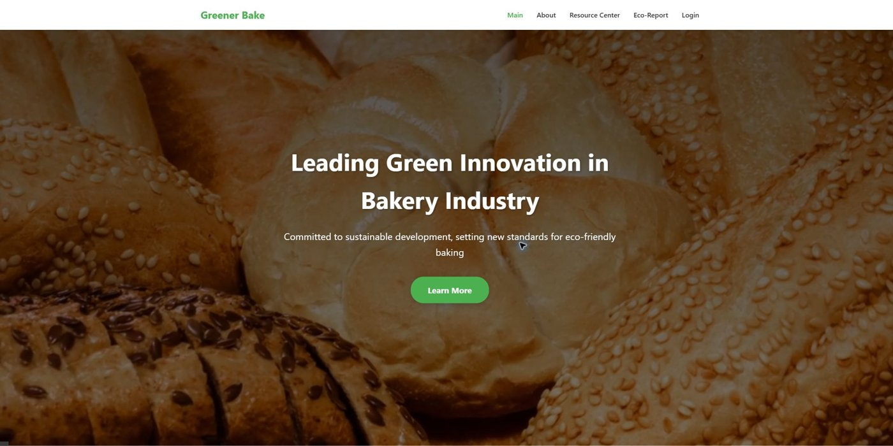
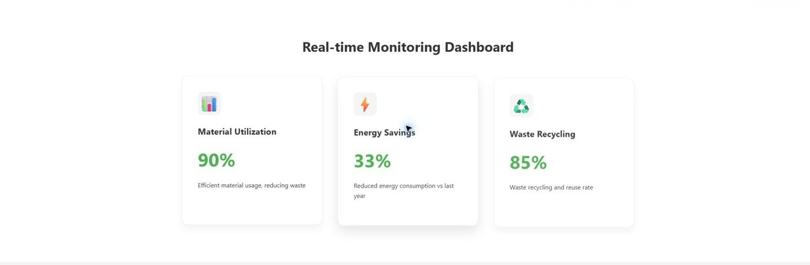
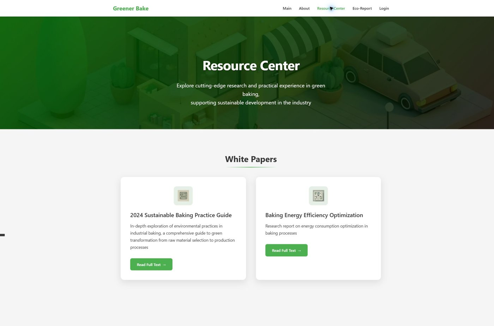
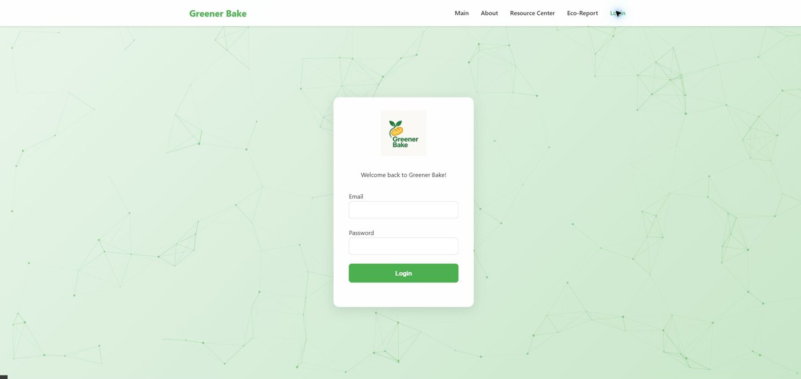

# Greener Baker

Authors: Xinya Shi, Yuxuan Zhang  
Authors: Shaohui Jing, Tianyi Ma

Greener Bake is a team-developed web application focused on sustainable bakery operations. It combines HTML, CSS and JavaScript pages with a Flask backend and a MySQL database accessed through SQLAlchemy.

## Features

- Sustainable production and resource-management pages.
- Carbon-footprint monitoring and reporting.
- Administrator and manager interfaces.
- Authentication and database-backed operational records.

## Screenshots

Screenshots captured from the original frontend pages. The dashboard uses the demonstration values included in the source; no database was connected for this preview.

| Home | Environmental indicators |
| :---: | :---: |
|  |  |

| Resource center | Login |
| :---: | :---: |
|  |  |

## Project structure

- `app.py`: Flask application and routes.
- `templates/`, `static/`, `assets/`: website pages and media.
- `models.py`, `config/`: data models and database configuration.
- `migrations/`, `scripts/`, `services/`: supporting project components.

## Local setup

1. Install Python and MySQL, then create a database named `greener_bake`.
2. Create a virtual environment and install the dependencies:

   ```bash
   python -m venv .venv
   # Windows: .venv\Scripts\activate
   # macOS/Linux: source .venv/bin/activate
   pip install -r requirements.txt
   ```

3. Copy `.env.example` to `.env` and set your own local database credentials and secret keys.
4. Start the application:

   ```bash
   python app.py
   ```

The development server runs at `http://127.0.0.1:5000` by default. This repository preserves the original coursework source. Local credentials, virtual environments and generated caches are excluded.
